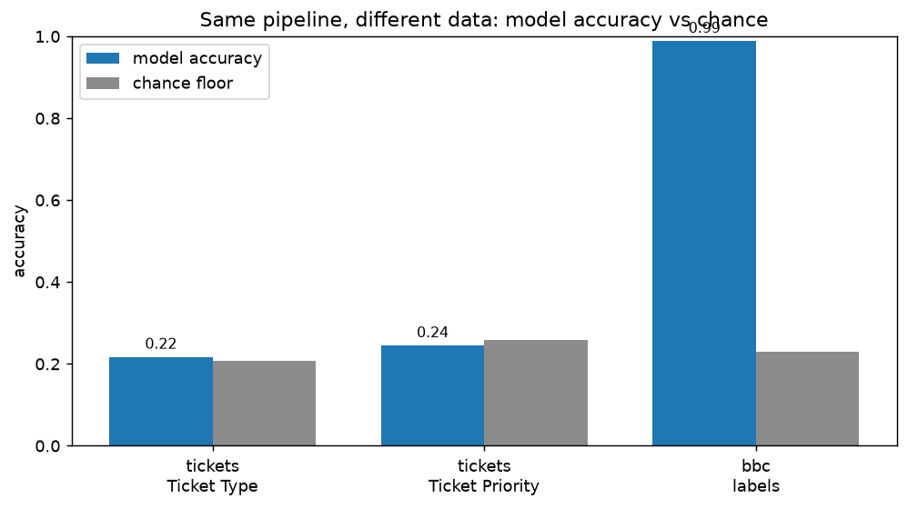
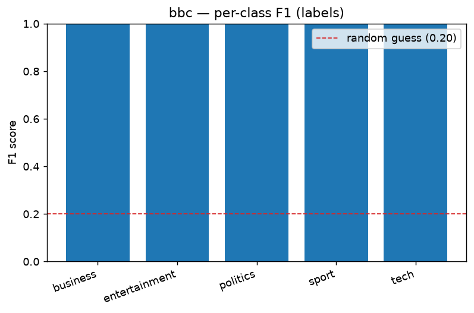
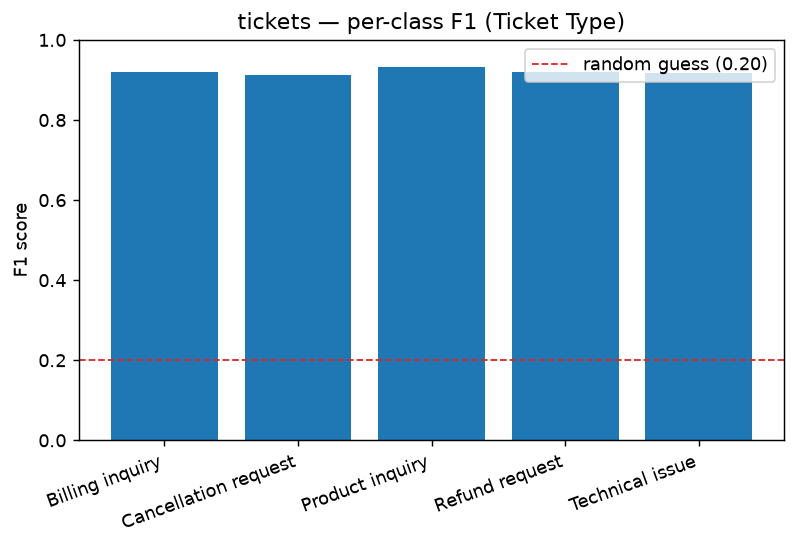

# Ticket Router ML — when a text classifier learns, and when it can't

A study on text classification for support-ticket routing. It asks the question below to test whether a ticket's type and priority can be predicted from its text:

> Can a standard text-classification pipeline predict support-ticket routing fields
> (**type**, **priority**) from the ticket's text? And what happens when the *same* method
> is pointed at a dataset that genuinely carries signal?

**Findings up front:**

- On a public *customer support tickets* dataset, the model lands **at chance** — it cannot
  predict type or priority, because the labels in that data are not grounded in the text.
- On **BBC News topic classification** — the *same pipeline*, changed by one line of config —
  the model reaches **98.9% accuracy** (5 topics).
- The contrast is the whole point: **method held constant, only the data changed.** A model
  is only as good as whether its data actually encodes the thing you are predicting.



---

## The method (identical for both datasets)

- **Features:** TF-IDF over the text, word 1–2 grams, up to 30k features, sublinear term
  frequency.
- **Classifier:** `LinearSVC` (one classifier per target column), class-weight balanced.
- **Validation:** stratified 5-fold cross-validation on the training split, plus a held-out
  20% test set. Vectorizer is fit **inside** each CV fold (no leakage).
- **Metric:** accuracy and macro-F1, always reported **next to a chance floor**
  (the larger of the most-frequent-class rate and `1 / n_classes`). A result only counts if
  it clearly beats that floor.

Swapping datasets is a one-line change (`DATASET=tickets` vs `DATASET=bbc`); the pipeline
code does not change. That is what makes the comparison fair.

## The data (both CC0 / public domain)

**Customer Support Tickets** — 8,469 rows. Input: subject + description. Targets:
Ticket Type (5 classes), Ticket Priority (4 classes).

- Classes are near-uniform (Type: 1634–1752 per class; Priority: 2063–2192 per class).
- **Every** description contains the literal placeholder `{product_purchased}` — the text is
  templated.

**BBC News** — 2,225 articles across 5 topics (sport 511, business 510, politics 417,
tech 401, entertainment 386). Input: article text. Target: topic.

Class distributions are charted in [`figures/`](figures/).

## Results

| Dataset | Target | Classes | Chance floor | Model accuracy | Macro-F1 | Verdict |
|---------|--------|--------:|-------------:|---------------:|---------:|---------|
| Tickets | Type | 5 | 0.207 | **0.217** | 0.217 | at chance |
| Tickets | Priority | 4 | 0.259 | **0.245** | 0.245 | at/below chance |
| BBC News | Topic | 5 | 0.229 | **0.989** | 0.989 | strong signal |

BBC cross-validation: macro-F1 **0.981 ± 0.005** over 5 folds — the held-out 0.989 is not a
lucky split. Full per-class reports and confusion matrices are in
[`results/`](results/RESULTS-bbc.md).




## Why the tickets data cannot be learned

This is a property of the **data**, not a failure of the model:

1. **The labels are near-uniformly random.** Each type/priority class has almost the same
   count, with no structure tying them to the text.
2. **The text is templated.** All 8,469 descriptions share the `{product_purchased}`
   placeholder, so there is little text variation to key on in the first place.

With no relationship between text and label, no model — simple or deep — can do better than
guessing. The pipeline measuring this correctly (landing exactly at the chance floor) is the
*right* outcome.

## What this means in practice

- A ticket router of this kind is entirely feasible — but it must be trained on **real**
  historical tickets, where the text genuinely relates to how agents classified them. Point
  the same pipeline at such data (one config entry) and the BBC result shows it will learn.
- Always compare against a chance baseline. A number like "25% accuracy" means nothing until
  you know the floor is 26%.

## Reproduce

```bash
python -m venv .venv && ./.venv/bin/python -m pip install -r requirements.txt
# BBC (real signal):
DATASET=bbc     ./.venv/bin/python -m src.train
DATASET=bbc     ./.venv/bin/python -m src.evaluate
DATASET=bbc     ./.venv/bin/python -m src.visualize
# Tickets (no signal):
DATASET=tickets ./.venv/bin/python -m src.train
DATASET=tickets ./.venv/bin/python -m src.evaluate
```

Datasets download automatically from their public (CC0) sources. The CSVs actually used are
also shipped in [`data/`](data/) for inspection.

## Repository contents

```
README.md            this report
FINDINGS.md          one-screen summary
MODEL-CARD.md        model description, intended use, limitations
config.py            dataset definitions (the one-line swap point)
src/                 pipeline: data, train, evaluate, visualize
results/             measured metrics (json) + full reports (md)
figures/             charts (solid-color bar charts)
models/              trained model artifacts (joblib)
data/                the CC0 training data used
requirements.txt     dependencies
LICENSE              MIT (code); datasets are CC0 — see below
```

## License & data

- **Code:** MIT (see `LICENSE`).
- **Data:** both datasets are **CC0: Public Domain** on their original sources; no
  attribution required. The tickets dataset contains synthetic PII-shaped fields (names,
  emails) that are **not** used as features — only subject + description text are used.
